# Pramaan — Civic Verification & Explainer Agent

> Forge Gen AI Buildathon — Theme 1 (Civic Pulse, Digital Governance &
> Public Information), combining Spectrum 1 (Multilingual Policy
> Explainer) and Spectrum 4 (Real-Time Fact-Verification Engine).

Pramaan is a civic verification and explainer agent. A user submits a
claim, screenshot, voice note, or government notification. Pramaan
fetches **live official evidence**, returns a verdict with clickable
source citations and timestamps, and generates a plain-language
regional voice explainer covering rights, eligibility, and real-world
impact. When evidence is weak or media shows synthetic-media risk
signals, it says so instead of guessing.

**No mock data. Every verdict hits a live source at runtime. Fallbacks
return honest errors.**

---

## Quick start

```bash
# 1. Install deps
pip install -r requirements.txt

# 2. Configure env
cp .env.example .env
# Edit .env and add your GEMINI_API_KEY (free at https://aistudio.google.com/apikey)

# 3. Phase 0 gate — prove live sources work before running the app
python -m tests.test_fetch_live

# 4. Start the backend (FastAPI)
uvicorn backend.app:app --reload --port 8000

# 5. In another terminal, start the Streamlit frontend
streamlit run frontend/streamlit_app.py
```

Open the Streamlit URL (usually `http://localhost:8501`).

---

## Architecture

```mermaid
flowchart LR
    U[User input: text / image / audio / PDF] --> INGEST
    INGEST[Ingest module: VLM / Whisper / pdfplumber] --> EXTRACT[Claim extraction: Gemini]
    EXTRACT --> Q[Build search queries]
    Q --> FETCH[Concurrent fetch: PIB + PIB Fact Check + Data.gov.in]
    FETCH --> CHUNK[Chunker: 400 tokens / 50 overlap]
    CHUNK --> EMBED[fastembed multilingual-MiniLM]
    EMBED --> FAISS[FAISS in-memory index]
    FAISS --> RETR[top-k=6 retrieval]
    RETR --> LLM[Verdict reasoning: Gemini, source-only]
    LLM --> GUARD[Guardrails: enforce citations + strip unverified URLs]
    GUARD --> RISK[Optional risk signals: EXIF, C2PA, domain]
    RISK --> TRANSLATE[Translate to en/hi/ta/bn]
    TRANSLATE --> RESP[VerifyResponse with audit trail]

    PDF[Government notification PDF] --> EXPLAIN[Explain pipeline]
    EXPLAIN --> RIGHTS[Rights / eligibility / impact]
    RIGHTS --> TTS[Optional Hindi TTS: edge-tts or Bhashini]
    TTS --> RESP2[ExplainResponse with audio_b64]
```



See [`ARCHITECTURE.md`](./ARCHITECTURE.md) for the full system design.

---

## Live data sources

| Source | Used for | Endpoint | Auth |
|---|---|---|---|
| **PIB Press Releases** | Real-time government announcements | `https://pib.gov.in/allRel.aspx?reg=48&lang=2` | None |
| **PIB Fact Check** | Debunked viral claims archive | `https://t.me/s/PIB_FactCheck` (Telegram public preview — PIB's own official channel) | None |
| **MyScheme** | Scheme eligibility metadata | _DISABLED_ — site is fully client-rendered, no SSR HTML to scrape. Marked `KNOWN_BROKEN` per spec section 11. Team can fix later by adding Playwright. | — |
| **Data.gov.in** | Open civic datasets | `https://api.data.gov.in/` | Free API key from https://api.data.gov.in/ |

Every fetch is logged (URL, status, latency, bytes) for the audit trail.

---

## API

### `POST /verify`

```json
{
  "input_type": "text" | "image" | "audio" | "pdf",
  "text": "...",
  "file_b64": "...",
  "language": "en" | "hi" | "ta" | "bn",
  "include_risk": true
}
```

Returns a `VerifyResponse` with `verdict`, `confidence`, `citations`
(each with a real URL + fetched_at timestamp), `reasoning_summary`,
`risk_signals`, and a full `audit_trail`.

### `POST /explain`

Returns a plain-language summary, `rights` / `eligibility` / `impact`
arrays, the document as a citation, and an optional `audio_b64` (mp3)
for the regional voice explainer.

### `GET /health`

```json
{"status": "ok", "sources_up": {"pib": true, "factcheck": true, ...}}
```

Hard 30s timeout per endpoint (spec section 5).

---

## Guardrails (spec section 8)

1. **`enforce_citations`** — if `verdict != "Insufficient Evidence"`
   and `citations` is empty, downgrade to Insufficient. No verdict
   without evidence.
2. **`strip_unverified_urls`** — remove any citation URL not in the
   set of URLs the fetcher actually returned. Kills hallucinated links.
3. **`enforce_schema`** — pydantic validation; raise on failure.

---

## Risk module — honest signals only

The risk module is called **"Provenance & Consistency Signals"** and
outputs SIGNALS with severity (low/medium/high) — never a binary
"fake/real" verdict.

Allowed signals:
- "EXIF metadata absent"
- "EXIF software tag present"
- "C2PA manifest present"
- "Reverse-image lookup not attempted" (honest disclosure)
- "Source domain not in official allowlist"

We NEVER output "this is a deepfake" or claim a probability is definitive.

---

## Demo script (spec section 12)

1. **Fake scheme WhatsApp message** (text) → `/verify` → `Contradicted`,
   cites a real PIB Fact Check URL with timestamp.
2. **Real government notification PDF** → `/explain` → rights + eligibility
   + impact + Hindi audio playback.
3. **Screenshot of a viral claim** → `/verify` with `include_risk` → verdict
   + risk signals panel + citations.
4. **Ambiguous claim** → `/verify` → `Insufficient Evidence` with the sources
   it did find. Say the line: "We refuse to guess."
5. Show the audit trail inline for one request.

---

## Tech stack

| Layer | Choice | Why |
|---|---|---|
| Backend | Python 3.11, FastAPI, pydantic v2 | Spec-mandated |
| Frontend | Streamlit | Spec-mandated; no React for a 2-person beginner team |
| LLM | Gemini 1.5 Flash (free tier: 15 RPM / 1500 RPD / 1M TPM) | Best free multimodal |
| Embeddings | `fastembed` (paraphrase-multilingual-MiniLM-L12-v2, CPU ONNX) | Same model as spec, no PyTorch dependency (saves 1.5GB) |
| Vector index | FAISS CPU in-memory | Spec-mandated, per-request |
| ASR | faster-whisper (small, CPU, int8) | Local, free, decent Hindi |
| TTS | edge-tts (Microsoft free) — Bhashini if key | Free, no API key needed |
| PDF parse | pdfplumber + pypdf fallback | Robust |
| HTTP | httpx (async) + selectolax (lexbor) | Spec-mandated, fast |

All free-tier friendly. No paid API keys required (Gemini has a free
tier; Bhashini is free for Indic; edge-tts is free).

---

## Deployment

- **Backend (FastAPI)**: Render free web service or Railway free tier.
  Spins down after 15 min idle (~30s cold start) — fine for demo.
- **Frontend (Streamlit)**: Streamlit Community Cloud (free forever,
  public URL, runs your streamlit_app.py directly from a GitHub repo).
- Set `BACKEND_URL` env var on the frontend to point at the backend URL.

---

## Known limitations (honesty scores points)

1. **MyScheme is disabled.** The official MyScheme site is a Next.js
   SPA with no server-side rendered scheme list and no discoverable
   JSON API. We've marked it `KNOWN_BROKEN` and skip it at runtime
   rather than fabricate scheme entries.
2. **PIB search is implicit.** The PIB website uses ASP.NET WebForms
   with `__VIEWSTATE`; its search endpoint returns the latest 24
   releases regardless of query. We scrape those 24 releases and let
   FAISS similarity pick the relevant ones — the recent-releases page
   is always fresh.
3. **Reverse-image lookup is NOT implemented.** We surface this as an
   honest signal ("Reverse-image lookup not attempted") rather than
   silently skipping it.
4. **C2PA detection is byte-pattern based.** We scan the first 8KB of
   the image for `c2pa` or `contentauthenticity` markers — this is a
   heuristic, not a full C2PA manifest parser.
5. **Hindi audio quality.** edge-tts (`hi-IN-MadhurNeural`) is decent
   but not native-quality. Switch `TTS_BACKEND=bhashini` if you have a
   Bhashini API key for better Indic voices.
6. **Single LLM model.** We use Gemini 1.5 Flash for everything (vision,
   reasoning, translation). More complex claims might benefit from
   GPT-4o for reasoning, but that adds cost.

---

## Project structure

```
pramaan/
├── backend/
│   ├── app.py              # FastAPI: /verify, /explain, /health
│   ├── config.py           # env vars, constants
│   ├── schemas.py          # pydantic models (defined BEFORE endpoints)
│   ├── ingest/             # image/audio/pdf -> text
│   ├── fetch/              # PIB, PIB Fact Check, MyScheme, Data.gov.in
│   ├── rag/                # embed + chunker + FAISS index
│   ├── reason/             # verify + explain + guardrails + prompts
│   ├── risk/               # EXIF, C2PA, domain reputation (signals only)
│   ├── voice/              # TTS + translate
│   ├── llm/                # Gemini client wrapper
│   └── utils/              # logging + audit trail recorder
├── frontend/
│   ├── streamlit_app.py    # two screens: Verify + Explain
│   └── styles.css
├── tests/
│   ├── test_fetch_live.py  # Phase 0 gate — MUST pass before demo
│   ├── test_verify.py      # pipeline smoke tests
│   └── test_guardrails.py  # pure-function tests
├── .env.example
├── requirements.txt
├── README.md  (this file)
└── ARCHITECTURE.md
```

---

## License

MIT — see repository for details. All source code is open. Data sources
(PIB, PIB Fact Check, Data.gov.in) are public and free to access.
